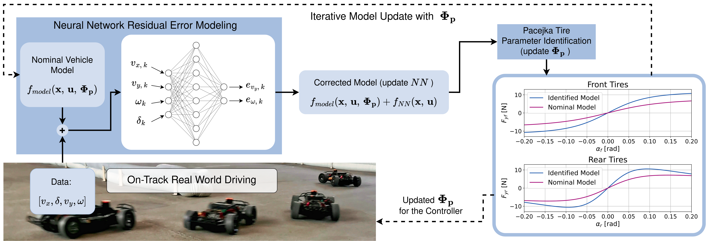

<a href="http://arxiv.org/abs/2411.17508">
    
</a>

On-track system identification is a data-driven approach to identifying tire-dynamics by simply driving around. Check out our preprint [Learning-Based On-Track System Identification for Scaled Autonomous Racing in Under a Minute](https://arxiv.org/abs/2411.17508) on ArXiv for more information. Or check out our explanatory [Youtube video](https://www.youtube.com/watch?v=4kLpSiZoAsE&feature=youtu.be).



## Introduction

This is a plain Python library that identifies the lateral (Pacejka) tire model of a single-track vehicle. It has no ROS dependency and does no file IO: it takes numpy arrays and parameters, and returns parameters.

It offers two methods that share the same vehicle model, Pacejka formula and fitting code:

- **On-track** (`identify_on_track`): from about 30-50 s of normal driving. A small neural network learns the error of a nominal vehicle model. Nominal model plus network then simulate a steady-state steering sweep, and Pacejka coefficients are fit to it. This repeats, with the refit model as the next nominal model, until the model converges.
- **Steady-state** (`identify_steady_state`): from dedicated quasi-steady-state runs (constant speed, slow steering ramp). Lateral forces follow directly from the steady-state assumption. It gives better tire data when there is space for such runs.

`generate_lut` turns an identified model into the steering look-up table used by the MAP controller of the [ForzaETH Race Stack](https://github.com/ForzaETH/race_stack), where the ROS 2 nodes and launch files wrapping this library live.

The original ROS 1 node is kept at tag [`v1.0-ros1`](https://github.com/ForzaETH/On-Track-SysID/tree/v1.0-ros1).

## Installation

```bash
pip install .            # steady-state identification and LUT generation (numpy, scipy)
pip install .[on_track]  # adds torch for on-track identification
```

The ForzaETH Race Stack installs it the same way, with `pip install .[on_track]`.

## Usage

```python
import numpy as np
from on_track_sysid import (VehicleParams, PacejkaParams, OnTrackConfig,
                            identify_on_track, identify_steady_state, generate_lut)

vehicle = VehicleParams(m=3.39, Iz=0.058, lf=0.168, lr=0.167, h_cg=0.014)
init = PacejkaParams(Bf=5.0, Cf=1.0, Df=1.5, Ef=0.5, Br=5.0, Cr=1.0, Dr=1.5, Er=0.5, friction_coeff=1.0)

# data: (N, 4) array of v_x [m/s], v_y [m/s], omega [rad/s], delta [rad], sampled at 50 Hz
tires = identify_on_track(data, vehicle, init, OnTrackConfig())
# or, from steady-state runs, with optional longitudinal acceleration for load transfer
tires = identify_steady_state(data, vehicle, init, a_x=a_x)

table = generate_lut(vehicle, tires)  # row 0: velocities, column 0: steering angles, cells: a_lat
```

Conventions:

- The Pacejka force is `F_y = mu * F_z * D * sin(C * atan(B * alpha - E * (B * alpha - atan(B * alpha))))`, with `mu = friction_coeff` (nominally 1.0).
- `v_y` is expected at the rear axle and moved to the center of gravity (`vy_at_rear_axle=True`); pass `False` when it is already at the center of gravity, e.g. in simulation.
- On-track data only counts samples above 1 m/s; collect it accordingly.

## Files

- `types.py`: `VehicleParams`, `PacejkaParams`.
- `pacejka.py`: Pacejka formula, axle loads, slip angles, steady-state forces, least-squares fit.
- `dynamics.py`: single-track lateral dynamics.
- `preprocess.py`: filtering, steering delay and mirroring of driving data.
- `on_track.py`: on-track identification.
- `steady_state.py`: steady-state identification.
- `lut.py`: steering look-up table generation.

Run the tests with `pytest tests` (the on-track test is skipped without torch).

## Citing On Track SysID

If you found our stack helpful in your research, we would appreciate if you cite it as follows:
```
@misc{dikici2024learningbasedontrackidentificationscaled,
      title={Learning-Based On-Track System Identification for Scaled Autonomous Racing in Under a Minute}, 
      author={Onur Dikici and Edoardo Ghignone and Cheng Hu and Nicolas Baumann and Lei Xie and Andrea Carron and Michele Magno and Matteo Corno},
      year={2024},
      eprint={2411.17508},
      archivePrefix={arXiv},
      primaryClass={cs.RO},
      url={https://arxiv.org/abs/2411.17508}, 
}
```
